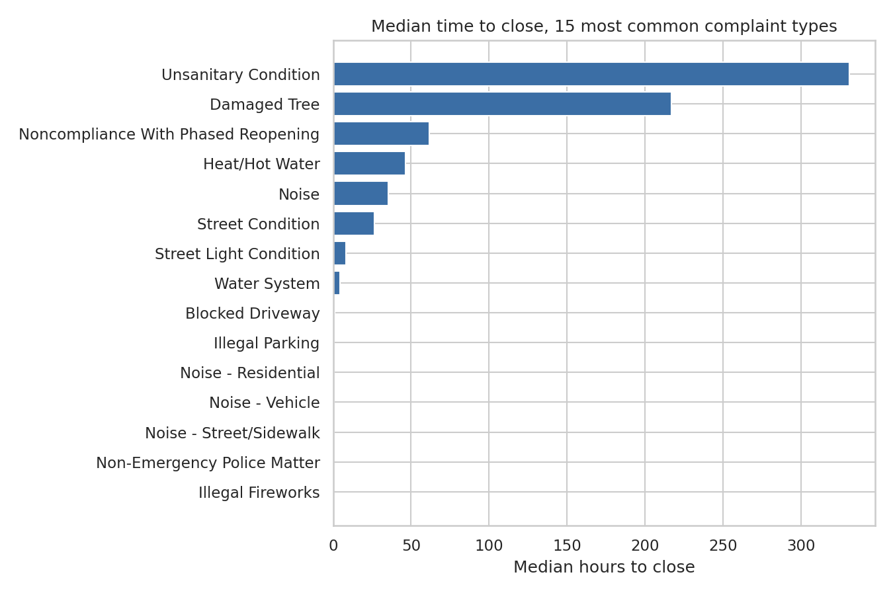
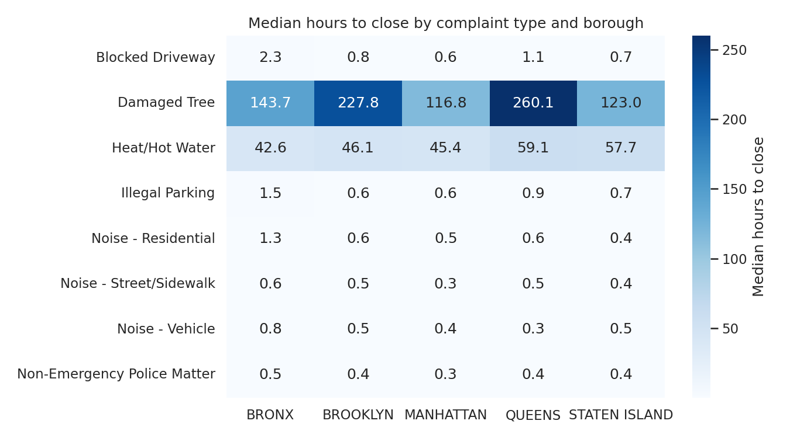

# NYC 311 Response Times

How long does New York City take to close a 311 service request, and does the answer depend on what you ask for and where you live?

This project analyzes 2.59 million 311 requests filed in 2020 using BigQuery SQL and pandas, with interactive dashboards in Tableau and Looker Studio.

**Dashboards:** [Tableau Public](https://public.tableau.com/views/NYC311ResponseTimes/HowlongdoesNYCtaketoanswera311request?:language=en-US&:sid=&:redirect=auth&:display_count=n&:origin=viz_share_link) | [Looker Studio](https://datastudio.google.com/reporting/f88970a0-21c5-4cd3-a73c-16230a93be4c)

## Key findings

1. **Most requests close within hours, but tree requests take months.** A New Tree Request took a median of 369 days to close. Three of the six slowest complaint types concern trees: New Tree Request, Dead/Dying Tree (52 days) and Illegal Tree Damage (45 days).
2. **Response times differ by borough.** Manhattan requests closed fastest, with a median of 1.4 hours and 67.1% closed within 24 hours. Staten Island was slowest, at 9.7 hours and 53.8%.
3. **The Bronx filed the most requests per resident.** It logged about 400 requests per 1,000 residents, compared with 224 per 1,000 in Staten Island.
4. **3.4% of requests had no usable close time.** Their closed date was either missing or earlier than the created date, so they count toward volume but are excluded from response times.

## Borough summary

| Borough | Requests | Requests per 1,000 residents | Median hours to close | Closed within 24 hours |
| --- | ---: | ---: | ---: | ---: |
| Bronx | 588,391 | 400 | 4.4 | 64.6% |
| Brooklyn | 732,466 | 268 | 3.4 | 60.6% |
| Manhattan | 518,409 | 306 | 1.4 | 67.1% |
| Queens | 598,099 | 249 | 3.0 | 63.7% |
| Staten Island | 111,124 | 224 | 9.7 | 53.8% |

Population figures are 2020 Census counts.

## Data quality

The notebook counts every problem in the raw data before changing anything.

| Issue | Rows | Share of raw data | How it was handled |
| --- | ---: | ---: | --- |
| Closed in the same minute it was created | 99,693 | 3.84% | Kept, and noted as a limitation |
| No closed date | 72,702 | 2.80% | Counted in volume, excluded from response times |
| Borough missing or "Unspecified" | 44,650 | 1.72% | Removed |
| Closed date earlier than created date | 19,961 | 0.77% | Counted in volume, excluded from response times |
| Open more than 365 days before closing | 6,613 | 0.26% | Kept; the reason medians are used instead of means |
| Duplicate request IDs | 0 | 0.00% | None found |

After cleaning, 2,548,489 requests remained, of which 2,463,065 had a usable close time. Only 2 of 185 complaint types were spelled more than one way.

## Method

1. **SQL (BigQuery).** Copied one year of requests from the public dataset, defined the cleaning rules in a view, and built summary tables using aggregations, a join to a borough population table, and window functions (`RANK` for the top complaint types in each borough, `LAG` for month-over-month change).
2. **Python (pandas).** Audited and cleaned the raw data in a Jupyter notebook, charted the results with Matplotlib and Seaborn, and exported summary files for Tableau.
3. **Validation.** Checked that the join neither dropped nor duplicated rows, and that the notebook's clean row count matched the SQL view.
4. **Dashboards.** Built a Tableau dashboard with a ZIP code map, monthly trend and complaint type comparison, and a Looker Studio report connected directly to the BigQuery tables.

## Limitations

- `closed_date` records when the agency closed the ticket, which is not always when the problem was fixed.
- 3.8% of requests were closed in the same minute they were created. This likely reflects agency logging practices and pulls some medians toward zero.
- Borough medians reflect each borough's mix of complaint types, so they do not by themselves show that one borough receives slower service.
- 2020 was a pandemic year, so volumes and response times may not be typical.

## Files

| File | Purpose |
| --- | --- |
| `sql/00_setup.sql` | Copies one year of requests and defines the cleaning rules |
| `sql/01_aggregation.sql` | Median time to close by complaint type and borough |
| `sql/02_join.sql` | Requests per 1,000 residents, joined to borough population |
| `sql/03_window_functions.sql` | Top complaint types per borough and month-over-month change |
| `311_cleaning.ipynb` | Data audit, cleaning, charts and Tableau exports |

## Data source

NYC 311 Service Requests, from the BigQuery public dataset `bigquery-public-data.new_york_311.311_service_requests`.

## Tools

BigQuery SQL, Python (pandas, Matplotlib, Seaborn), Jupyter (Google Colab), Tableau Public, Looker Studio.